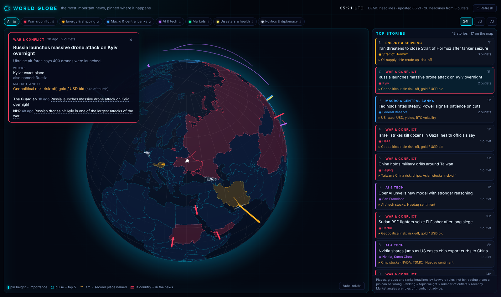

# World Globe

A dark 3D globe with the most important world news (war, energy and shipping, central banks and the economy, AI and tech, markets, crypto, disasters, politics, music) pinned to where each story happens, with a ranked feed beside it. The aim is to stay informed at a glance.



## Run it

```bash
python3 server.py            # http://127.0.0.1:8770/
python3 server.py 9000       # another port
python3 server.py --demo     # made-up headlines from test/demo_headlines.json (works offline)
python3 server.py --lan      # also reachable from other devices on your network
```

You need only Python 3 and a modern browser: no installs, no build step and no API keys. The server is needed because browsers can't read news RSS feeds directly (CORS). It fetches the feeds and serves the page.

## Online (GitHub Pages)

`.github/workflows/pages.yml` publishes the site to GitHub Pages on every push and every 30 minutes. It runs the tests, fetches the feeds (`scripts/build_feed.py` writes `public/data/world.json`, the same JSON `/api/world` serves) and deploys `public/`. The page tries `/api/world` first and falls back to `data/world.json`, so the same files work with or without the server. If every feed fails, the run fails and the last good site stays up.

One-time setup: **Settings → Pages → Source: GitHub Actions**. GitHub Pages on a private repo needs a paid GitHub plan; on a free plan the repo must be public. GitHub pauses scheduled workflows after 60 days with no commits; re-enable it from the Actions tab if that happens.

## How it works

| Piece | File | What it does |
|---|---|---|
| Feeds | `server.py` | Fetches BBC World and Business, Al Jazeera, Guardian World, NPR World, France 24, CNBC World, TechCrunch AI, CoinDesk, Cointelegraph, Decrypt, Billboard, Rolling Stone, Pitchfork and NME RSS in parallel. Each feed is cached for 10 minutes, and a failed feed keeps its last good copy. `GET /api/world` returns the newest 800 headlines. |
| Videos | `server.py` | The public YouTube feeds of Al Jazeera English, BBC News, DW News, France 24 English and Sky News (no key). Each video becomes a headline with a video id and joins the matching story by word overlap. |
| Placing and ranking | `public/geo.js` | Pure logic that runs in the browser and in Node. See the rules below. |
| Globe and feed | `public/app.js` | [globe.gl](https://github.com/vasturiano/globe.gl) (stored in the repo under `public/vendor/`), Natural Earth country outlines, the ranked feed, filters and story cards. |

**Placing a story.** The headline and summary are matched against a hand-made list of places. A precise place (Strait of Hormuz, Kyiv, Gaza, Taiwan Strait) wins over an institution (Fed, ECB, OPEC, Nvidia HQ). An institution wins over a country, which is pinned at its centre and labelled "country". A country wins over a leader (Trump goes to the White House, Putin to the Kremlin). A second place, if one is named, becomes an arc. Stories with no known place stay in the feed as "not on the map".

**Ranking.** Topic weight (war 1.0 down to music 0.55, so music and crypto rarely top the All view but lead their own filter) × (1 + 0.6 per extra outlet covering the same story, up to 5) × 0.5^(age / 12 h). The same story from several outlets is merged by word overlap.

**Market angle.** A fixed rule of thumb per topic and region (for example "Oil supply risk: crude up, risk-off"). It is not advice and not a forecast.

**Limits.** This is keyword matching, not understanding. A place that is only mentioned in passing can get the pin, and the same story worded very differently can show up twice. The page says this too.

## Calendar tab

The **Calendar** tab (next to Top stories) lists the week's high-impact meetings and data releases for the major currencies: rate decisions, press conferences, central bankers' speeches, CPI, PCE, jobs, GDP and so on. Times are in your time zone, with a countdown and a **LIVE** badge during the event. "High + medium" shows more events.

- **Sources:** this week's events come from the ForexFactory weekly calendar (faireconomy JSON). That feed has no next week, so later FOMC decisions and US CPI releases come from the Fed / BLS schedules in `public/cal.js` (marked "scheduled"; extend it yearly).
- **On the globe:** clicking an event pins it at its central bank (Fed in Washington, ECB in Frankfurt, BoE in London, BoJ in Tokyo, ...).
- **Live video:** under the card, a player for the event's live stream: the official channel first for central-bank events (Federal Reserve, ECB, Bank of England), then finance TV (CNBC, Bloomberg, Yahoo Finance). It uses YouTube's live embed, which plays whatever the channel is streaming now; when the channel isn't live it shows offline, so switch channels or watch the official channel's latest upload (for example the last press conference). Channel ids are resolved from their @handles by the server.

## Using it

- Topic buttons and the 24h / 3d / 7d window filter both the feed and the globe. Both choices are remembered.
- Hovering a story flies the globe to it. Clicking a story pins it on the globe (a pulsing marker, plus an arc if it names a second place) and opens its card: every outlet's link, the place and how sure the placement is, and the market angle. Press Esc to close the card.
- Any story with a matching news video (▶ video in the list) plays it, muted, in a panel under the story card. Unmute it in the player or open it on YouTube. Closing the card stops it. A video is matched to a story by keywords too, so now and then it can be a related clip rather than the exact event.
- The globe stays clean: only the selected story gets a pin. Countries in the news light up in their story's colour.
- The page refreshes every 5 minutes while the tab is visible. The globe stops rendering while the tab is hidden.

## Tests

```bash
node test/geo.test.js        # placing, country lookup, categories, grouping, recency
node test/cal.test.js        # calendar: schedule, kinds, merge, status / live window, streams
python3 test/server_test.py  # RSS parsing + demo feed (no network)
```

## Adding places

Add an entry to `GAZ` (exact spots, institutions, leaders) or `COUNTRIES` in `public/geo.js`, then add a case to `test/geo.test.js`. Levels: 3 = exact spot, 2.5 = institution / company HQ, 2 = country, 1.5 = leader or seat of government.

## Licences

globe.gl and three.js: MIT. Country outlines: Natural Earth via world-atlas (public domain). Headlines and links belong to their publishers. The app shows titles and short summaries and links to the original articles.
